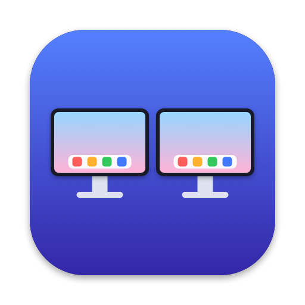

<p align="center">
  
</p>

<h1 align="center">AlwaysDock</h1>

<p align="center">
  <b>Show the macOS Dock on every display.</b><br>
  A Dock replacement for multi-monitor Macs that stays visible on all screens, every Space and full-screen apps.
</p>

<p align="center">
  
  
  
  <a href="LICENSE"></a>
</p>

The macOS Dock shows on **one** display at a time and hides in full-screen apps, and Apple offers no setting to change that. AlwaysDock draws its own dock, which looks and behaves like the real one, on **every display** and every Space, including full-screen apps.

## Features

- A separate dock on each display. It updates on its own when you connect or disconnect a display.
- On every Space, and stays put in Mission Control.
- Around full-screen content (full-screen apps, slideshows, games, video) it acts like the real Dock: it hides, and slides in when you push the pointer against its edge.
- The app list comes from the system Dock: Finder, your pinned apps (in the same order), a separator, then running apps that are not pinned. Running apps come and go as they launch and quit; pinned apps re-sync every 3 seconds.
- A small dot under each running app. Hovering an icon shows the app's name in a bubble.
- Click to launch an app or bring it to the front. If the app has no windows left, it opens a new one, like the Dock does.
- Right-click (or Control-click) for a menu: Open, Show in Finder, Hide/Show, Quit. Hold ⌥ to turn Quit into Force Quit.
- Drop files on an icon to open them with that app.
- Liquid Glass background on macOS 26 and later, vibrancy on older versions. Follows light and dark mode.
- Can sit on the bottom, left or right edge. Icons shrink to fit when space runs out.
- Optional space reservation: zoomed (Zoom/Fill) and tiled windows are not covered by the dock.

## Requirements

- macOS 13 or later.
- Xcode 15 or later, or its Command Line Tools (install with `xcode-select --install`). The package needs Swift 5.9 or later.

## Build and run

Get the source:

```bash
git clone https://github.com/paduvi/always-dock.git && cd always-dock
```

Build the app:

```bash
./build.sh
```

```bash
open build/AlwaysDock.app
```

To install the app and launch it (recommended if you want Open at Login):

```bash
./build.sh --install
```

The app goes into `/Applications`. If you have no admin rights, meaning `/Applications` is not writable, the script installs into your `~/Applications` instead. To install somewhere else, pass a folder (it is created if missing):

```bash
./build.sh --install ~/Tools
```

The running copy quits cleanly and is replaced by the new one. If an old copy is still in `/Applications` or `~/Applications`, the script tells you so you can delete it and avoid launching the old version.

During development you can run it without packaging a `.app`. Open at Login does not work this way:

```bash
swift run
```

## Usage

AlwaysDock has no icon in the Dock. All settings are under the dock icon in the menu bar:

| Item | What it does |
| --- | --- |
| **Hide System Dock** | Hides the macOS Dock completely so AlwaysDock takes over on every display. Quitting AlwaysDock brings the system Dock back. |
| **Auto-Hide in Full Screen** | On by default. The dock gets out of the way of full-screen content, like the macOS Dock (see below). |
| **Reserve Space for Dock** | Zoomed and tiled windows shrink so the dock does not cover them. Requires Accessibility access (see below). |
| **Icon Size** | Small (40), Medium (48), Large (64). |
| **Position** | Bottom, Left, Right. Defaults to wherever the system Dock is. |
| **Open at Login** | Starts AlwaysDock when you log in. Only available when running from `AlwaysDock.app`. |
| **Quit AlwaysDock** | ⌘Q |

### Two modes

1. **Default (Hide System Dock off)**: AlwaysDock steps aside on the display that currently has the system Dock and shows only on the others. When the system Dock moves to another display, AlwaysDock follows within about a second. In this mode, full-screen apps on the display with the system Dock have no dock.
2. **Hide System Dock on** (recommended): AlwaysDock is on **every** display, including the main display and full-screen apps.

### Auto-Hide in Full Screen

With this option on, AlwaysDock treats full-screen content the way the macOS Dock does:

- When a window fills a display edge to edge, the dock on that display hides. This covers full-screen apps (the green button), slideshows, games, full-screen video and any other window that takes over the whole screen. Push the pointer against the dock's edge to bring the dock in. It hides again once the pointer moves away. The dock fades in and out rather than popping.
- Opening or closing a full-screen app slides the desktop away or back, and the dock goes and comes back with the desktop, as the system Dock does. It does not show up on the full-screen app afterwards, nor while you switch between full-screen apps.
- When the active app asks macOS to hide the Dock, as games, slideshows and kiosk apps often do, AlwaysDock disappears from every display until that app stops asking or is no longer active. Pushing the pointer against the edge does not bring it back, the same as with the system Dock.
- Windows that sit above the dock's window level already cover the dock and need nothing extra.

Turn the option off to keep the dock in view over full-screen apps.

### Reserve Space for Dock

The real Dock reserves space by shrinking the screen's usable area (`visibleFrame`), so macOS knows how far a window may zoom. Only macOS can do that; third-party apps cannot. So AlwaysDock does what window managers such as Rectangle and Amethyst do: it watches windows through the Accessibility API, and when a window **is resized or opens** overlapping the dock's strip, it shrinks the window to fit.

- Zoom, Fill, tiling and dragging a window edge into the dock strip all end in a resize, so they all get adjusted. When you drag an edge, AlwaysDock waits until you release the mouse.
- Just **moving** a window (no resize) is left alone. You can still place a window over the dock if you want, like with the real Dock.
- Full-screen windows, minimized windows, sheets and panels are never adjusted. The display that has the system Dock is not touched either, since macOS already handles it.
- When you turn the option on, or change the dock's size or position, windows that are already open are checked again. A dock that hides for full-screen content and comes back does not trigger this, so entering and leaving full screen stays smooth.

**Granting access:** turn on Reserve Space for Dock. macOS asks for permission; open System Settings → Privacy & Security → Accessibility and turn on AlwaysDock. On macOS 27 that list is called **Device Control and Data Access** instead of Accessibility. While it waits, the menu item reads "(waiting for Accessibility access)" and an **Open Accessibility Settings…** item below it jumps straight to the right list. Once access is granted the feature starts on its own, without relaunching the app.

You can also open the list from Terminal:

```bash
open "x-apple.systempreferences:com.apple.settings.PrivacySecurity.extension?Privacy_Accessibility"
```

**After a rebuild:** `build.sh` signs the app ad-hoc, so after every build macOS treats it as a new app and the old Accessibility grant stops working. The switch in System Settings may still show as on but has no effect. Remove AlwaysDock from the list (the − button) and grant access again, or reset the stale entry from Terminal and let AlwaysDock ask again:

```bash
tccutil reset Accessibility io.dogy.AlwaysDock
```

If you have a code signing certificate, build with it and the grant survives rebuilds:

```bash
SIGN_IDENTITY="Apple Development: Your Name (XXXXXXXXXX)" ./build.sh --install
```

## How it works

- Each display gets a borderless `NSPanel` that never takes focus (`nonactivatingPanel`). The panel sits at the same window level as the real Dock (`kCGDockWindowLevel`), with a `collectionBehavior` of `canJoinAllSpaces`, `fullScreenAuxiliary` and `stationary`.
- Pinned apps are read from the `persistent-apps` key in `com.apple.dock`. Running apps come from `NSWorkspace` and are followed through KVO instead of being polled, since reading an app's details is a round trip to LaunchServices.
- To find the display the system Dock is on, AlwaysDock looks for the display whose `visibleFrame` is inset on the bottom, left or right edge.
- A display counts as full screen when an on-screen window below the dock's level covers all of it (`CGWindowListCopyWindowInfo`), leaving out the strip beside the camera housing on displays that have one. Apps that hide the Dock are found through `NSApplication.currentSystemPresentationOptions`. A dock out of view stays ordered in, transparent and click-through, because each dock is one window on every Space: while macOS slides between Spaces, the window list reports the dock moving along with one of them, and AlwaysDock judges full screen on that Space, from the windows that move with the dock. That is how the dock leaves with the desktop and comes back with it. The window list is checked once a second, and every 50 ms for a second after a Space change, a change in presentation options, or a change in a dock's occlusion state (the dock is covered or uncovered as a slide starts, and as it leaves the screen). While a dock auto-hides, AlwaysDock checks the pointer position ten times a second.
- Hide System Dock uses a well-known trick: turn on auto-hide with a 1000-second delay (`autohide-delay`) and restart the Dock. Your original values are saved and restored when you turn the option off or quit the app. Both changes are logged under the `io.dogy.AlwaysDock` subsystem, which you can follow in Console.

## Limitations

- macOS does not let third-party apps reserve screen space the way the real Dock does. Reserve Space for Dock makes up for it by adjusting windows *after* they resize, so you may see a window zoom all the way and then shrink. Some apps enforce a minimum size or refuse resizing through Accessibility; AlwaysDock skips those.
- Full-screen windows cannot be resized, so the dock covers the bottom of a full-screen app while it is slid in, or all the time with Auto-Hide in Full Screen off.
- Any window that fills a display counts as full screen, including a borderless window that an app sizes to the whole screen.
- Pinning, unpinning and reordering apps is still done in the system Dock. While the system Dock is hidden, press ⌥⌘D to show it temporarily, then press ⌥⌘D again to hide it.
- Not supported yet: badges, minimized windows, folders (Stacks), the Trash, hover magnification.
- If AlwaysDock is killed abruptly (a crash, `kill -9`) while the system Dock is hidden, open AlwaysDock again and turn the option off, or run this to get the Dock back:

```bash
defaults delete com.apple.dock autohide-delay; defaults write com.apple.dock autohide -bool false; killall Dock
```

## Source code

| File | Contents |
| --- | --- |
| `Sources/AlwaysDock/main.swift` | Starts the app as a menu-bar-only app. |
| `Sources/AlwaysDock/AppDelegate.swift` | Creates a dock per display, tracks display changes, the menu bar menu. |
| `Sources/AlwaysDock/DockPanelController.swift` | Builds, positions and auto-hides the dock on one display. |
| `Sources/AlwaysDock/Views.swift` | The panel window, glass background, icon tiles, separator, app-name bubble. |
| `Sources/AlwaysDock/DockModel.swift` | The app list (pinned and running); launching and activating apps. |
| `Sources/AlwaysDock/SystemDock.swift` | Reads the system Dock's settings; hides and restores the system Dock. |
| `Sources/AlwaysDock/FullScreen.swift` | Auto-Hide in Full Screen: finds displays that a window fills. |
| `Sources/AlwaysDock/WindowGuard.swift` | Reserve Space for Dock: watches other apps' windows through the Accessibility API and shrinks them. |
| `Sources/AlwaysDock/Settings.swift` | Stores user settings. |
| `build.sh` | Packages `build/AlwaysDock.app` (signed ad-hoc, or with `SIGN_IDENTITY`). With `--install [DIR]`: quits the running copy cleanly, installs into `/Applications` (or `~/Applications`, or `DIR`) and launches it. |
| `Resources/AppIcon.icns` | The app icon. |
| `Scripts/make-icon.swift` | Draws the icon in code and regenerates `AppIcon.icns`: `swift Scripts/make-icon.swift`. |
| `docs/icon.png` | The icon as a PNG, for this README. |

## License

AlwaysDock is free and open source under the [MIT License](LICENSE).
